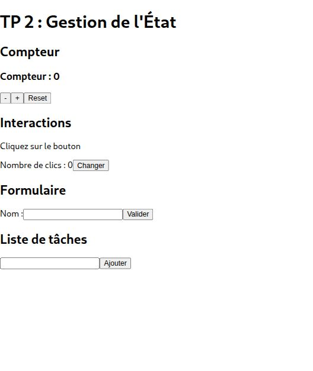
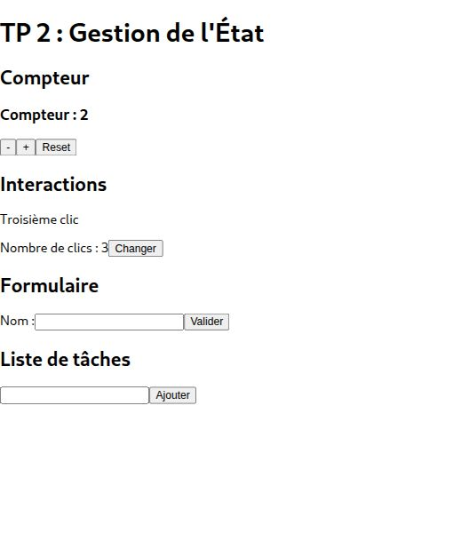
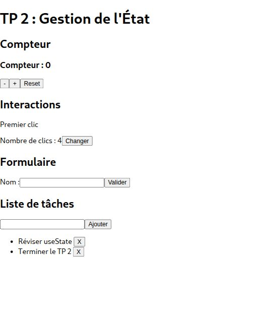
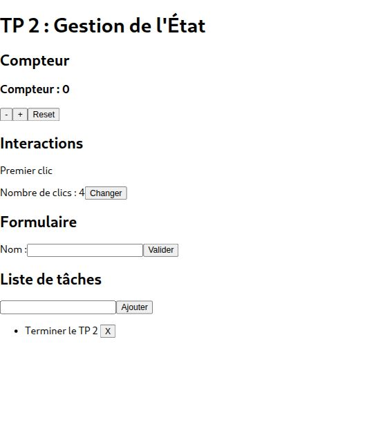
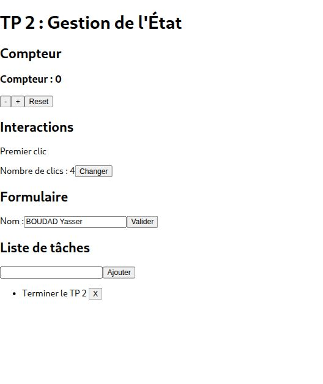
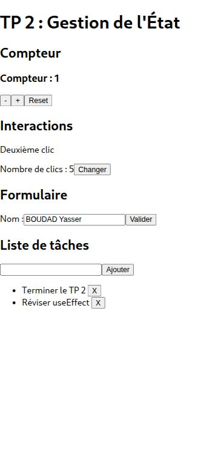

# Lab2-tp-state

**Réalisé par : BOUDAD Yasser**

Compteur, interactions, formulaire et liste de tâches.

Compteur à 2 et troisième message affiché.

Deux tâches ajoutées à la liste.

La première tâche est supprimée ; la seconde reste affichée.

Nom saisi dans le formulaire. La validation affiche une alerte.

Affichage dans une fenêtre de navigateur au format mobile.

